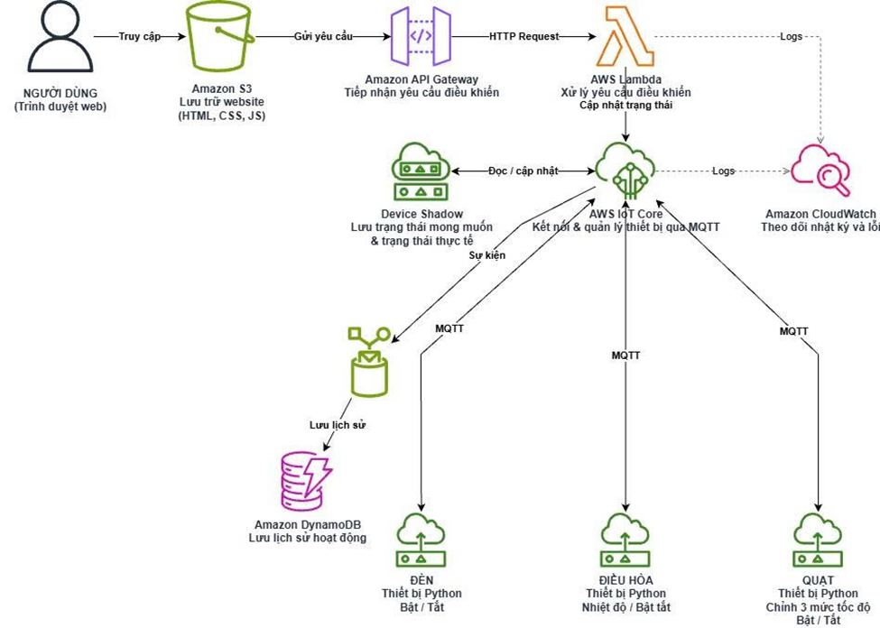

# Nhà Thông Minh Điều Khiển Thiết Bị Giả Lập Qua AWS IoT Core

> **Môn học:** Điện toán đám mây (Cloud Computing) – Đợt 1 – Năm học 2026–2027  
> **Giảng viên hướng dẫn:** TS. Huỳnh Xuân Phụng  
> **Nhóm thực hiện:** Integration & IoT  

---

## Thành viên nhóm

| Họ và tên | MSSV | Vai trò & Nhiệm vụ chính |
| :--- | :---: | :--- |
| **Trần Nguyễn Minh Hiếu** | `24110212` | Thiết kế IoT Things, chứng chỉ X.509, IoT Policy (Least Privilege); lập trình Device Simulator (`simulator.py` hỗ trợ auto-reconnect); cấu hình IoT Rule ghi lịch sử vào DynamoDB; kiểm thử End-to-End. |
| **Nguyễn Trung Kiên** | `24110263` | Thiết kế bảng DynamoDB, hàm AWS Lambda, HTTP API Gateway (cấu hình CORS & Validation); xây dựng Web Dashboard trên Amazon S3; thiết lập giám sát CloudWatch Logs/Alarms và mẫu CloudFormation IaC. |

---

## Kiến trúc hệ thống



### Luồng hoạt động End-to-End:
1. **Người dùng (Web Dashboard trên Amazon S3):** Truy cập giao diện web tĩnh và gửi lệnh bật/tắt hoặc thay đổi thông số của 3 thiết bị (`smart-light`, `smart-ac`, `smart-fan`).
2. **Amazon API Gateway & AWS Lambda:** API Gateway nhận HTTP Request (`POST /devices/{thingName}/control`), chuyển tiếp đến hàm `SmartHomeControlFunction`. Lambda kiểm tra tính hợp lệ của dữ liệu đầu vào (Validation) và gọi API cập nhật trạng thái mong muốn (`desired`) lên **AWS IoT Device Shadow**.
3. **AWS IoT Core & Thiết bị giả lập (Python Simulator):** Device Shadow phát sinh bản tin chênh lệch trạng thái (`delta`) qua topic `$aws/things/{thingName}/shadow/update/delta`. Chương trình `simulator.py` kết nối qua giao thức **MQTT over TLS (mTLS port 8883)** nhận bản tin `delta`, cập nhật trạng thái nội bộ và phản hồi trạng thái thực tế (`reported`) về lại topic `$aws/things/{thingName}/shadow/update`.
4. **AWS IoT Rule & Amazon DynamoDB:** Khi Shadow cập nhật thành công (`/shadow/update/accepted`), IoT Rule `SaveShadowToDynamoDBRule` tự động trích xuất `deviceId`, `timestamp`, `eventType`, `state` và lưu trữ vào bảng DynamoDB `SmartHomeDeviceHistory`.
5. **Amazon CloudWatch:** Ghi nhận toàn bộ log thực thi của Lambda/API Gateway và kích hoạt cảnh báo (Alarms) khi phát sinh lỗi `Errors >= 1` hoặc `5XX`.

---

## Thông tin hạ tầng triển khai trên AWS Learner Lab

* **AWS Account ID:** `1436-1588-5844`
* **AWS Region:** `us-east-1` (US East - N. Virginia)
* **IAM Execution Role:** `LabRole` (tuân thủ quy định của AWS Learner Lab)
* **AWS IoT Data Endpoint:** `a1vt5536hy0pad-ats.iot.us-east-1.amazonaws.com`
* **IoT Things (3 thiết bị):** `smart-light`, `smart-ac`, `smart-fan`
* **IoT Security Policy:** `SmartHomeDevicePolicy` (Áp dụng nguyên tắc quyền tối thiểu - Least Privilege)
* **IoT Rule:** `SaveShadowToDynamoDBRule` (Action: `DynamoDBv2`)
* **DynamoDB Table:** `SmartHomeDeviceHistory` (Partition key: `deviceId` [String], Sort key: `timestamp` [Number], chế độ On-Demand)
* **Lambda Function:** `SmartHomeControlFunction` (Runtime: Python 3.12)
* **API Gateway (HTTP API):** `https://xcibzup2li.execute-api.us-east-1.amazonaws.com`
* **S3 Static Website Endpoint:** `http://iot-smarthome-website.s3-website-us-east-1.amazonaws.com`
* **CloudWatch Alarms:** `SmartHomeLambdaErrorAlarm` & `SmartHomeAPIGateway5XXAlarm`

---

## Cấu trúc thư mục dự án

```text
aws-iot-device-shadow-smarthome/
├── certs/                            # Chứa chứng chỉ X.509 & Private Key (Đã chặn trong .gitignore)
├── iac/                              # Cấu hình hạ tầng (IaC) & Chính sách bảo mật
│   ├── template.yaml                 # CloudFormation Template khởi tạo bảng DynamoDB
│   ├── iot-policy.json               # Nội dung SmartHomeDevicePolicy (Least Privilege)
│   └── s3-bucket-policy.json         # Chính sách đọc công khai cho S3 Static Website
├── logs/                             # Nhật ký hoạt động (Log) thực tế của 3 thiết bị giả lập
│   ├── device_simulator.log          # Log kiểm thử Tuần 2
│   └── device_simulator_week3.log    # Log kiểm thử Tuần 3 (Auto-reconnect & 3 devices)
├── reports/                          # Báo cáo tiến độ hàng tuần & minh chứng
│   ├── BaoCaoTuan2.md                # Báo cáo tiến độ Tuần 2
│   ├── BaoCaoTuan3.md                # Báo cáo tiến độ Tuần 3
│   └── docs/                         # Hình ảnh chụp màn hình minh chứng & sơ đồ kiến trúc
├── src/                              # Mã nguồn chính của hệ thống
│   ├── devices/
│   │   └── simulator.py              # Trình giả lập 3 thiết bị IoT (MQTT mTLS, Shadow, Auto-reconnect)
│   └── lambda/
│       └── lambda_function.py        # Hàm Lambda xử lý API điều khiển & truy vấn lịch sử DynamoDB
├── tests/                            # Dữ liệu mẫu phục vụ kiểm thử (Test payloads)
│   ├── lambda-test-event.json        # Event JSON kiểm thử hàm Lambda
│   └── shadow-desired-sample.json    # Mẫu JSON cập nhật trạng thái Device Shadow
├── web/                              # Giao diện người dùng (Frontend)
│   └── index.html                    # Bảng điều khiển Smart Home & xem lịch sử thiết bị
├── .gitignore                        # Chặn tuyệt đối các tệp khóa bảo mật (*.pem, *.key, certs/, .env)
└── README.md                         # Tài liệu hướng dẫn tổng quan của dự án
