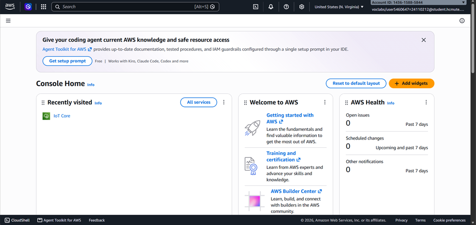
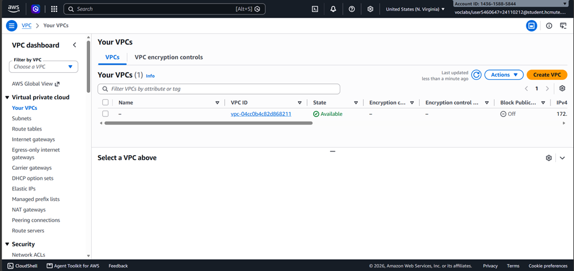
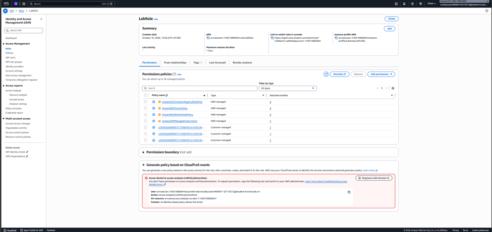
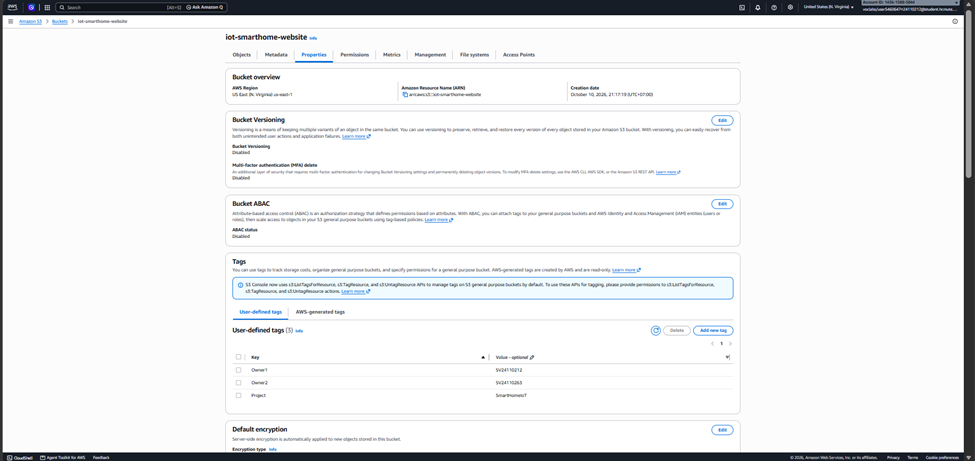

# BÁO CÁO CÔNG VIỆC TUẦN 1
**ĐỀ TÀI: NHÀ THÔNG MINH – ĐIỀU KHIỂN THIẾT BỊ GIẢ LẬP QUA AWS IoT CORE**

* **Môn học:** Cloud - Đợt 1 - 2026–2027
* **Nhóm:** Integration & IoT
* **Giảng viên hướng dẫn:** Huỳnh Xuân Phụng
* **Thời gian thực hiện:** Tuần 1
* **Số lượng thành viên:** 2 sinh viên

---

## 1. Mục tiêu tuần 1
Trong tuần đầu tiên, nhóm tập trung tìm hiểu các dịch vụ AWS cần sử dụng cho đề tài nhà thông minh, xây dựng ý tưởng và thiết kế sơ đồ hoạt động của hệ thống. Bên cạnh đó, nhóm tiến hành chuẩn bị môi trường AWS Learner Lab, tìm hiểu cách sử dụng quyền được cấp và tạo các tài nguyên nền tảng cần thiết.

Các mục tiêu chính trong tuần gồm:
* Tìm hiểu chức năng của các dịch vụ AWS được yêu cầu trong đề tài.
* Xác định cách các dịch vụ kết nối và hoạt động cùng nhau.
* Thiết kế kiến trúc tổng thể cho hệ thống nhà thông minh.
* Vẽ sơ đồ kiến trúc để làm cơ sở triển khai ở các tuần tiếp theo.
* Chuẩn bị môi trường AWS, kiểm tra Region và quyền sử dụng dịch vụ.
* Tìm hiểu và chuẩn bị các tài nguyên nền tảng như VPC, IAM LabRole và S3.
* Gắn tag cho các tài nguyên có hỗ trợ để dễ quản lý và nhận biết.

---

## 2. Nội dung công việc

### 2.1. Tìm hiểu các dịch vụ AWS
Nhóm tiến hành tìm hiểu những dịch vụ AWS cần sử dụng theo yêu cầu của đề tài, bao gồm AWS IoT Core, AWS Lambda, API Gateway, DynamoDB và S3.

* **AWS IoT Core:** Dùng để kết nối và trao đổi dữ liệu với các thiết bị nhà thông minh. Các thiết bị giả lập sẽ giao tiếp với hệ thống thông qua giao thức MQTT.
* **AWS Lambda:** Dùng để xử lý các yêu cầu điều khiển thiết bị khi người dùng thao tác trên website.
* **Amazon API Gateway:** Tiếp nhận yêu cầu từ website và chuyển đến Lambda xử lý.
* **Amazon DynamoDB:** Dùng để lưu lại lịch sử hoạt động của các thiết bị.
* **Amazon S3:** Dùng để lưu trữ các tệp giao diện website điều khiển nhà thông minh.

Ngoài ra, nhóm tìm hiểu thêm về **Device Shadow**, là chức năng giúp lưu trạng thái mong muốn và trạng thái thực tế của thiết bị. Nhóm cũng tìm hiểu cách sử dụng AWS IoT Rule để chuyển dữ liệu sự kiện sang DynamoDB và CloudWatch để theo dõi hoạt động của hệ thống.

Qua quá trình tìm hiểu, nhóm xác định được vai trò của từng dịch vụ và cách kết hợp chúng để xây dựng hệ thống hoàn chỉnh.

### 2.2. Thiết kế kiến trúc hệ thống
Sau khi tìm hiểu các dịch vụ, nhóm tiến hành xác định các thành phần chính của hệ thống nhà thông minh.

Hệ thống dự kiến có ba thiết bị giả lập gồm đèn, điều hòa và quạt. Người dùng sẽ điều khiển các thiết bị thông qua website được lưu trữ trên S3.

Khi người dùng thực hiện thao tác trên website, yêu cầu sẽ được gửi đến API Gateway và chuyển đến Lambda xử lý. Lambda cập nhật trạng thái mong muốn của thiết bị trên AWS IoT Core. Chương trình thiết bị nhận lệnh, thay đổi trạng thái mô phỏng và gửi trạng thái thực tế trở lại hệ thống.

Bên cạnh đó, AWS IoT Rule sẽ được sử dụng để chuyển các sự kiện phù hợp vào DynamoDB nhằm lưu lịch sử hoạt động.

### 2.3. Vẽ sơ đồ kiến trúc
Dựa trên kiến trúc đã xác định, nhóm tiến hành xây dựng sơ đồ tổng thể để thể hiện mối quan hệ giữa các thành phần trong hệ thống.

Sơ đồ gồm các thành phần chính:
* Website điều khiển được lưu trữ trên Amazon S3.
* API Gateway tiếp nhận yêu cầu từ website.
* Lambda xử lý yêu cầu điều khiển.
* AWS IoT Core quản lý kết nối và trạng thái thiết bị.
* Ba thiết bị giả lập được viết bằng Python.
* DynamoDB lưu lịch sử hoạt động của thiết bị.
* CloudWatch theo dõi nhật ký hoạt động và lỗi.

Sơ đồ này được sử dụng làm tài liệu tham khảo trong quá trình triển khai ở các tuần tiếp theo.

**Hình 1. Sơ đồ kiến trúc tổng thể hệ thống nhà thông minh**  

### 2.4. Chuẩn bị môi trường AWS Learner Lab
Nhóm chuẩn bị môi trường triển khai trên AWS Learner Lab theo yêu cầu của môn học.

Các công việc gồm:
* Khởi động môi trường Learner Lab và truy cập AWS Management Console.
* Chọn Region `us-east-1` (US East – N. Virginia) theo quy định.
* Kiểm tra quyền truy cập và các dịch vụ có thể sử dụng trong môi trường được cấp.
* Tìm hiểu cách quản lý tài nguyên và theo dõi những dịch vụ đã tạo.
* Xác định các giới hạn cần tuân thủ để tránh sử dụng tài nguyên vượt mức cho phép.

Nhóm thực hiện triển khai trên AWS Learner Lab theo yêu cầu của giảng viên. Các tài nguyên được tạo trong Region `us-east-1` và sử dụng quyền được cấp sẵn trong môi trường học tập. Trong quá trình thực hiện, nhóm tuân thủ các quy định về sử dụng tài nguyên và quản lý chi phí.

**Hình 2. Giao diện AWS Management Console và Region triển khai**  

### 2.5. Tìm hiểu và chuẩn bị VPC
Nhóm tìm hiểu về VPC để nắm được cách AWS tổ chức một mạng riêng cho các tài nguyên khi cần sử dụng trong hệ thống.

VPC cho phép xác định phạm vi mạng, dải địa chỉ IP và các thiết lập mạng liên quan. Đây là kiến thức cần thiết khi triển khai những tài nguyên cần giao tiếp với nhau trong AWS.

Trong tuần đầu, nhóm xem xét nhu cầu sử dụng mạng của đề tài và kiểm tra môi trường hiện có. Do chương trình Python có thể chạy trên máy tính cá nhân và kết nối đến AWS IoT Core qua Internet, nhóm không tạo thêm tài nguyên mạng nếu chưa cần thiết. Việc sử dụng VPC sẽ được thực hiện theo nhu cầu thực tế và quyền được cấp trong Learner Lab.

**Hình 3. Thông tin VPC trong AWS Console**  

### 2.6. Kiểm tra quyền IAM LabRole
Nhóm tìm hiểu cách sử dụng quyền được cung cấp trong AWS Learner Lab để triển khai các dịch vụ cần thiết.

Theo yêu cầu của đề tài, nhóm sử dụng `LabRole` hoặc `LabInstanceProfile` khi phù hợp với từng dịch vụ và không tự tạo IAM role mới.

Nhóm xác định rằng các dịch vụ cần được cấp quyền phù hợp với chức năng sử dụng. Ví dụ, Lambda cần có quyền thực hiện công việc được giao; những quyền truy cập không cần thiết sẽ không được cấp thêm.

Việc kiểm tra quyền ngay từ đầu giúp nhóm chủ động hơn khi triển khai các dịch vụ ở tuần 2 và hạn chế những lỗi do thiếu quyền truy cập.

**Hình 4. Thông tin quyền hoặc LabRole được cấp trong môi trường học tập**  

### 2.7. Chuẩn bị Amazon S3
Nhóm tìm hiểu cách sử dụng Amazon S3 để lưu trữ các tệp giao diện website của hệ thống nhà thông minh.

Website dự kiến gồm các tệp HTML, CSS và JavaScript, cho phép người dùng xem trạng thái thiết bị và gửi yêu cầu điều khiển.

Trong tuần đầu, nhóm xác định mục đích sử dụng S3, cách tạo bucket và cách quản lý tài nguyên. Việc đưa giao diện website lên S3 và kết nối với API Gateway sẽ được thực hiện trong các tuần tiếp theo.

Tên bucket sẽ được đặt theo quy tắc phù hợp với yêu cầu của AWS và khả năng sử dụng trong Learner Lab.

**Hình 5. Bucket S3 dùng cho dự án nếu đã được tạo**  

### 2.8. Gắn tag và quản lý tài nguyên
Để thuận tiện trong quá trình triển khai, nhóm thống nhất cách đặt tên và gắn tag cho các tài nguyên AWS có hỗ trợ.

Ba tag chính được sử dụng là:

| Tag | Giá trị mẫu | Mục đích |
|---|---|---|
| **Project** | `SmartHomeIoT` | Xác định tài nguyên thuộc đề tài |
| **Owner1** | `SV24110212` | Xác định người phụ trách / Thành viên 1 |
| **Owner2** | `SV24110263` | Xác định người phụ trách / Thành viên 2 |

Việc gắn tag giúp nhóm dễ nhận biết tài nguyên của dự án khi xem danh sách trên AWS Console. Đồng thời, nhóm có thể kiểm tra lại các tài nguyên đã tạo để tránh nhầm lẫn với tài nguyên khác.

Nhóm cũng chú ý dừng hoặc xóa những tài nguyên không còn sử dụng sau mỗi buổi thực hành, đồng thời kiểm tra các dịch vụ có thể tiếp tục phát sinh chi phí.

---

## 3. Kết quả công việc tuần 1
Sau khi thực hiện các công việc tìm hiểu và chuẩn bị, nhóm hướng đến những kết quả sau:
* Nắm được chức năng cơ bản của các dịch vụ AWS cần sử dụng trong đề tài.
* Xác định được các thành phần chính và cách hệ thống nhà thông minh hoạt động.
* Xây dựng sơ đồ kiến trúc tổng thể làm cơ sở triển khai.
* Chuẩn bị môi trường AWS Learner Lab và xác định Region sử dụng.
* Tìm hiểu cách sử dụng VPC, quyền LabRole và Amazon S3.
* Thống nhất cách đặt tên và gắn tag cho tài nguyên.
* Xác định các công việc cần tiếp tục thực hiện trong tuần 2.

Tình trạng hoàn thành của từng nội dung sẽ được cập nhật theo kết quả triển khai thực tế của nhóm. Những tài nguyên chưa tạo hoặc những nội dung chưa thực hiện sẽ được ghi nhận là đang chuẩn bị hoặc dự kiến thực hiện.

---

## 4. Phân công công việc & Nhật ký thời gian (Worklog)

### Bảng phân công công việc
| Thành viên | Công việc phụ trách |
|---|---|
| **Nguyễn Trung Kiên** | Tìm hiểu các dịch vụ AWS, kiểm tra môi trường Learner Lab, tìm hiểu VPC và quyền LabRole |
| **Trần Nguyễn Minh Hiếu** | Tìm hiểu chức năng hệ thống, thiết kế kiến trúc, vẽ sơ đồ và tìm hiểu cách sử dụng S3 |
| **Cả nhóm** | Thống nhất kiến trúc, kiểm tra yêu cầu, đặt quy tắc đặt tên và gắn tag tài nguyên |

### Nhật ký thời gian làm việc (Worklog)
| Thành viên | Nội dung công việc | Số giờ thực tế |
|---|---|---|
| **Nguyễn Trung Kiên** | Tìm hiểu dịch vụ và chuẩn bị môi trường AWS | 5 giờ |
| **Nguyễn Trung Kiên** | Tìm hiểu VPC, LabRole và quản lý tài nguyên | 3 giờ |
| **Trần Nguyễn Minh Hiếu** | Thiết kế kiến trúc và vẽ sơ đồ | 4 giờ |
| **Trần Nguyễn Minh Hiếu** | Tìm hiểu S3 và quy tắc gắn tag | 4 giờ |
| **Tổng cộng** | | **16 giờ** (Mỗi SV: 8 giờ) |

---

## 5. Kết luận
Trong tuần 1, nhóm tập trung tìm hiểu các dịch vụ AWS, xác định yêu cầu hệ thống, thiết kế kiến trúc và chuẩn bị nền tảng triển khai trên AWS Learner Lab. Các công việc này giúp nhóm hiểu rõ hơn về cách tổ chức hệ thống và xác định được thứ tự thực hiện trong những tuần tiếp theo.

Ở tuần 2, nhóm sẽ tiếp tục triển khai các chức năng kết nối thiết bị, cập nhật trạng thái và xử lý yêu cầu điều khiển. Nhóm sẽ bổ sung hình ảnh minh chứng và cập nhật kết quả thực tế để theo dõi tiến độ của đề tài.