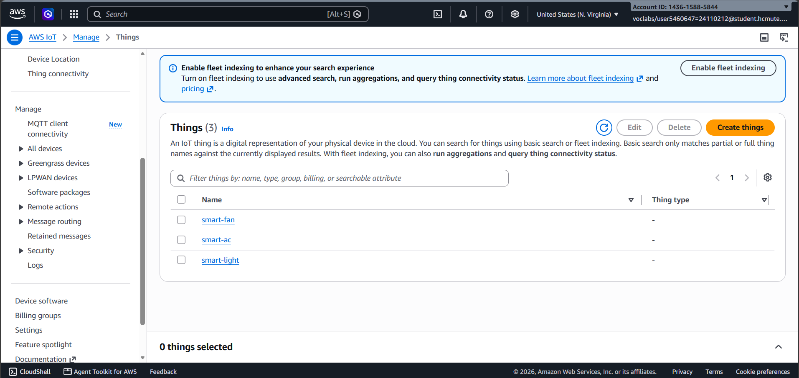

# BÁO CÁO TIẾN ĐỘ TUẦN 2 – ĐỀ TÀI: NHÀ THÔNG MINH ĐIỀU KHIỂN THIẾT BỊ GIẢ LẬP QUA AWS IoT CORE

**Môn học:** Cloud – Đợt 1 – Năm học 2026–2027
**Nhóm:** Integration & IoT
**Giảng viên hướng dẫn:** TS. Huỳnh Xuân Phụng
**Thời gian báo cáo:** 12/10/2026 – 18/10/2026
**GitHub Repository (Public):** https://github.com/NguyenTrungKien1805/aws-iot-device-shadow-smarthome
**Báo cáo tuần 2:** `reports/BaoCaoTuan2.md`
**Sơ đồ kiến trúc hệ thống:** `reports/docs/architecture-diagram.png`

> Báo cáo phân biệt kết quả đã có ảnh/log trong repository với các mục chưa có đủ minh chứng. Nhóm cần đối chiếu trạng thái AWS thực tế trước khi nộp.

---

## 1. MỤC TIÊU VÀ KẾT QUẢ ĐẠT ĐƯỢC TRONG TUẦN 2

Theo kế hoạch tuần 1, tuần 2 tập trung **triển khai các chức năng lõi trên AWS Learner Lab và kiểm thử từng thành phần riêng lẻ**.

Các kết quả đã có minh chứng trong repository:

- Tạo 3 Thing trên AWS IoT Core (smart-light, smart-ac, smart-fan), gắn certificate và IoT Policy.

  **Danh sách Thing trên AWS IoT Core**<br>
  
  **Thuộc tính Thing: smart-light**<br>
  
  **Thuộc tính Thing: smart-ac**<br>
  
  **Thuộc tính Thing: smart-fan**<br>
  
  **Target của IoT Policy**<br>
  
  **Certificate của smart-light**<br>
  
  **Certificate của smart-ac**<br>
  
  **Certificate của smart-fan**<br>
  
- Kiểm thử MQTT (publish/subscribe) bằng MQTT test client.
  **Data endpoint của AWS IoT**<br>
  
  **Kiểm thử MQTT bằng MQTT test client**<br>
  
- Xây dựng chương trình Python mô phỏng 3 thiết bị, nhận lệnh `delta` và cập nhật `reported`.
  **Chạy mô phỏng thiết bị**<br>
  
- Kiểm thử Device Shadow theo luồng desired → delta → reported.
  **Ghi nhận thay đổi Device Shadow của smart-light**<br>
  
  **Document Device Shadow sau cập nhật**<br>
  

**Các hạng mục cần bổ sung minh chứng hoặc xác nhận trạng thái:**

- Tạo bảng DynamoDB lưu lịch sử thiết bị.
- Triển khai Lambda xử lý yêu cầu điều khiển (cập nhật desired) và kiểm thử riêng.
- Cấu hình API Gateway tích hợp Lambda, có endpoint kiểm thử được.
- Cấu hình IoT Rule ghi sự kiện Shadow vào DynamoDB (nếu kịp trong tuần).
- Chuẩn bị S3 phục vụ giao diện web.
- Gắn tag Project/Owner cho tài nguyên mới; dừng/xóa tài nguyên không cần thiết sau mỗi buổi làm. *(Có ảnh tag của IoT Policy; cần xác nhận các tài nguyên khác và danh sách tài nguyên đã dừng/xóa.)*
  **Tag của IoT Policy**<br>
  

---

## 2. BẢNG TỔNG HỢP PHÂN CÔNG VÀ SỐ GIỜ LÀM VIỆC

### 2.1. Phân công nhiệm vụ

| Thành viên | MSSV | Vai trò và nhiệm vụ chính | Số giờ cá nhân | Tổng số giờ |
|---|---|---|---|---|
| Trần Nguyễn Minh Hiếu | 24110212 | Cấu hình AWS IoT Core (Thing, certificate, policy); kiểm thử MQTT và Device Shadow; xây dựng chương trình Python mô phỏng Smart Light, Smart AC, Smart Fan | 8 giờ | 8 giờ |
| Nguyễn Trung Kiên | 24110263 | Tạo bảng DynamoDB; triển khai và kiểm thử Lambda; cấu hình API Gateway tích hợp Lambda; chuẩn bị S3 cho giao diện web | 8 giờ | 8 giờ |
| **Tổng cộng** | | | **16 giờ** | **16 giờ** |

> Yêu cầu: mỗi sinh viên tối thiểu **8 giờ/tuần**.

### 2.2. Nhật ký công việc (Worklog)

| Ngày thực hiện | Thành viên | Nội dung công việc | Thời gian |
|---|---|---|---|
| 12/10/2026 | Trần Nguyễn Minh Hiếu | Tạo Thing, certificate, IoT Policy; tải certificate; kiểm thử MQTT test client | 4 giờ |
| 13/10/2026 | Trần Nguyễn Minh Hiếu | Viết chương trình Python 3 thiết bị; kiểm thử nhận delta và cập nhật reported | 4 giờ |
| 14/10/2026 | Nguyễn Trung Kiên | Tạo bảng DynamoDB; viết và kiểm thử Lambda (test event trên Console) | 4 giờ |
| 15/10/2026 | Nguyễn Trung Kiên | Cấu hình API Gateway, bật CORS, kiểm thử endpoint; kiểm tra S3 | 4 giờ |
| **Tổng cộng** | 2 thành viên | | **16 giờ** |

---

## 3. CHI TIẾT CÔNG VIỆC VÀ MINH CHỨNG TRÊN GITHUB

### 3.1. Trần Nguyễn Minh Hiếu – MSSV: 24110212

#### a. Cấu hình AWS IoT Core và kiểm thử MQTT (4 giờ)

- Tạo 3 Thing: `smart-light`, `smart-ac`, `smart-fan` (Region `us-east-1`).
- Tạo certificate cho từng Thing, kích hoạt (Active) và tải về: certificate, private key, Amazon Root CA 1.
- Ảnh minh chứng ghi nhận IoT Policy được liên kết với Thing. Nội dung policy mẫu dưới đây minh họa cách giới hạn quyền theo tên Thing; cần đối chiếu với policy đang cấu hình trên AWS trước khi xác nhận phạm vi quyền thực tế:

```json
{
  "Version": "2012-10-17",
  "Statement": [
    { "Effect": "Allow", "Action": "iot:Connect",
      "Resource": "arn:aws:iot:us-east-1:<ACCOUNT_ID>:client/${iot:Connection.Thing.ThingName}" },
    { "Effect": "Allow", "Action": ["iot:Publish", "iot:Receive"],
      "Resource": "arn:aws:iot:us-east-1:<ACCOUNT_ID>:topic/$aws/things/${iot:Connection.Thing.ThingName}/shadow/*" },
    { "Effect": "Allow", "Action": "iot:Subscribe",
      "Resource": "arn:aws:iot:us-east-1:<ACCOUNT_ID>:topicfilter/$aws/things/${iot:Connection.Thing.ThingName}/shadow/*" }
  ]
}
```

- Lấy endpoint dữ liệu của tài khoản (`aws iot describe-endpoint --endpoint-type iot:Data-ATS`) và kiểm thử publish/subscribe bằng **MQTT test client** trên Console.
- Certificate/private key lưu trong thư mục `certs/` **đã được liệt kê trong `.gitignore`**, không đưa lên GitHub.
#### b. Chương trình Python mô phỏng thiết bị và kiểm thử Device Shadow (4 giờ)

Mỗi thiết bị là một tiến trình Python kết nối MQTT bằng certificate, thực hiện:

1. Kết nối AWS IoT Core (TLS, xác thực bằng certificate).
2. Subscribe topic `$aws/things/<thing>/shadow/update/delta`.
3. Khi nhận `delta`: cập nhật trạng thái nội bộ (mô phỏng bật/tắt, chỉnh thông số).
4. Publish trạng thái mới vào `$aws/things/<thing>/shadow/update` (trường `reported`).

Cấu trúc Shadow dự kiến cho từng thiết bị:

| Thiết bị | Thuộc tính |
|---|---|
| Smart Light | `power` (ON/OFF), `brightness` (0–100) |
| Smart AC | `power`, `temperature` (16–30), `mode` (cool/dry/fan) |
| Smart Fan | `power`, `speed` (1–3) |

Đoạn mã minh họa luồng xử lý delta (nhóm chỉnh sửa theo SDK thực tế đã dùng):

```python
import json, os
from awsiot import mqtt_connection_builder   # gói awsiotsdk

THING = os.environ["THING_NAME"]
mqtt = mqtt_connection_builder.mtls_from_path(
    endpoint=os.environ["IOT_ENDPOINT"],
    cert_filepath=f"certs/{THING}.cert.pem",
    pri_key_filepath=f"certs/{THING}.private.key",
    ca_filepath="certs/AmazonRootCA1.pem",
    client_id=THING,
)
state = {"power": "OFF", "brightness": 0}

def on_delta(topic, payload, **kwargs):
    delta = json.loads(payload).get("state", {})
    state.update(delta)
    report = {"state": {"reported": state}}
    mqtt.publish(f"$aws/things/{THING}/shadow/update", json.dumps(report), qos=1)

mqtt.connect().result()
mqtt.subscribe(f"$aws/things/{THING}/shadow/update/delta", qos=1, callback=on_delta)
```

Kiểm thử: gửi `desired` từ Console (Shadow → Edit) → thiết bị nhận `delta` → cập nhật `reported` → `delta` biến mất. Ghi lại log và ảnh chụp.

**Ảnh minh chứng chạy mô phỏng và cập nhật Device Shadow:**


Minh chứng GitHub:
- Mã nguồn: [src/devices/simulator.py](../src/devices/simulator.py)
- Log kiểm thử: [logs/device_simulator.log](../logs/device_simulator.log)

### 3.2. Nguyễn Trung Kiên – MSSV: 24110263

#### a. DynamoDB và Lambda (4 giờ)

Bảng lịch sử thiết bị (thiết kế dự kiến):

| Thuộc tính | Kiểu | Vai trò |
|---|---|---|
| `deviceId` | String | Partition key |
| `timestamp` | Number | Sort key (epoch ms) |
| `eventType` | String | Loại sự kiện (ví dụ `SHADOW_UPDATE`) |
| `state` | Map/String | Dữ liệu trạng thái liên quan |

- Chế độ capacity dự kiến: On-demand (tránh phát sinh chi phí cố định); cần xác nhận trên cấu hình bảng thực tế.
- Lambda dự kiến dùng Python 3.12 và **LabRole** làm execution role, nhận yêu cầu từ API Gateway và gọi `iot-data:UpdateThingShadow` để cập nhật `desired`. Mẫu bên dưới kiểm tra tên thiết bị và body cơ bản; cần kiểm tra cấu hình và kiểm thử thực tế trước khi xem đây là triển khai hoàn tất. Biến môi trường: `IOT_ENDPOINT`.

```python
import json, os, boto3

iot = boto3.client("iot-data", endpoint_url=f"https://{os.environ['IOT_ENDPOINT']}")
ALLOWED = {"smart-light", "smart-ac", "smart-fan"}

def lambda_handler(event, context):
    thing = event["pathParameters"]["thingName"]
    body = json.loads(event.get("body") or "{}")
    if thing not in ALLOWED or not isinstance(body, dict) or not body:
        return resp(400, {"message": "invalid request"})
    iot.update_thing_shadow(
        thingName=thing,
        payload=json.dumps({"state": {"desired": body}}),
    )
    return resp(200, {"thing": thing, "desired": body})

def resp(code, obj):
    return {"statusCode": code,
            "headers": {"Content-Type": "application/json",
                        "Access-Control-Allow-Origin": "*"},
            "body": json.dumps(obj)}
```

- Kịch bản cần kiểm thử: gửi test event hợp lệ/không hợp lệ trên Console; xác nhận Shadow nhận `desired` và CloudWatch Logs có log.

#### b. API Gateway và S3 (4 giờ)

- Route dự kiến cho REST/HTTP API: `POST /devices/{thingName}/control` (tích hợp Lambda), `GET /devices/{thingName}/shadow` (nếu kịp).
- Cấu hình CORS để giao diện web trên S3 gọi được API.
- Lệnh kiểm thử endpoint dự kiến bằng `curl`/Postman:

```bash
curl -X POST https://<api-id>.execute-api.us-east-1.amazonaws.com/<stage>/devices/smart-light/control \
  -H "Content-Type: application/json" -d '{"power":"ON","brightness":80}'
```

- Ảnh [tag S3 tuần 1](docs/images/Week1Pic/s3-tags.png) là minh chứng về bucket đã có; trạng thái static website hosting và phần chuẩn bị giao diện tuần 2 cần được xác nhận riêng.

Minh chứng GitHub:
- Mã Lambda: Chưa có mã Lambda trong repository.
- Cấu hình/ghi chú API: Chưa có tài liệu cấu hình API trong repository.

---

## 4. KẾT QUẢ KIỂM THỬ TỪNG THÀNH PHẦN

| Thành phần | Kịch bản kiểm thử | Kết quả mong đợi | Kết quả thực tế | Minh chứng |
|---|---|---|---|---|
| IoT Core / MQTT | Publish/subscribe bằng MQTT test client | Nhận được thông điệp | Đã kiểm thử; ảnh MQTT test client ghi nhận thông điệp | [MQTT test client](docs/images/Week2Pic/MQTT%20test%20client_smarthome.png) |
| Device Shadow | Đặt `desired` khác `reported` | Thiết bị nhận delta, cập nhật reported | Đạt với `smart-light`: nhận delta, cập nhật trạng thái và publish `reported` theo log | [Document Shadow](docs/images/Week2Pic/Update%20Device%20shadow%20document%20của%20smart-light.png), [log thay đổi](docs/images/Week2Pic/Simulate%20Recording%20Smart%20Light%20Device%20Shadow%20Changes.png) |
| Python simulator | Chạy 3 thiết bị đồng thời | Cả 3 kết nối và phản hồi lệnh | Cả 3 thiết bị kết nối và subscribe; log ghi nhận `smart-light` phản hồi delta | [Ảnh chạy mô phỏng](docs/images/Week2Pic/Run%20simulation.png), [log](../logs/device_simulator.log) |
| DynamoDB | Ghi và đọc 1 bản ghi mẫu | Bản ghi hiển thị đúng | Chưa có kết quả kiểm thử hoặc minh chứng trong repository | Chưa có |
| Lambda | Test event hợp lệ / không hợp lệ | 200 / 400 | Chưa có kết quả kiểm thử hoặc minh chứng trong repository | Chưa có |
| API Gateway | `curl` POST điều khiển đèn | Shadow `desired` được cập nhật | Chưa có kết quả kiểm thử hoặc minh chứng trong repository | Chưa có |
| IoT Rule → DynamoDB | Cập nhật Shadow | Có bản ghi mới trong bảng | Chưa có kết quả kiểm thử hoặc minh chứng trong repository | Chưa có |

**Lỗi gặp phải và cách khắc phục:**

| Lỗi | Nguyên nhân | Cách khắc phục |
|---|---|---|
| Chưa có lỗi và cách khắc phục nào được ghi trong log/tài liệu hiện có. | Chưa có dữ liệu xác nhận. | Chưa có dữ liệu xác nhận. |

> Các hạng mục chưa có kết quả kiểm thử/minh chứng cần được nhóm xác nhận; nếu chưa hoàn thành thì chuyển tiếp sang kế hoạch tuần 3.

---

## 5. QUẢN LÝ TÀI NGUYÊN, TAG VÀ CHI PHÍ

- Ảnh trong repository ghi nhận tag của IoT Policy: `Project = SmartHomeIoT`, `Owner1 = SV24110212`, `Owner2 = SV24110263`. Chưa có đủ minh chứng để xác nhận các tài nguyên khác đều được gắn tag.
- Ảnh [cấu hình Region tuần 1](docs/images/Week1Pic/console-region.png) và [LabRole tuần 1](docs/images/Week1Pic/iam-labrole.png) ghi nhận phạm vi sử dụng `us-east-1` và **LabRole**. Cần kiểm tra lại cấu hình thực tế của từng dịch vụ nếu có thay đổi trong tuần 2.
- Tài nguyên có minh chứng trong repository: 3 Thing (`smart-light`, `smart-ac`, `smart-fan`) và IoT Policy. Trạng thái các tài nguyên AWS đang chạy vào cuối tuần chưa được ghi nhận.
- Tài nguyên đã dừng/xóa sau buổi làm: Chưa có dữ liệu ghi nhận.
- Chi phí ước tính tuần 2: Chưa có số liệu Billing/Cost Explorer trong repository.

---

## 6. KHAI BÁO SỬ DỤNG AI

### 6.1. Công cụ AI đã sử dụng

- **Công cụ:** Copilot trong VS Code.
- **Mô hình ghi nhận:** Không có thông tin tên mô hình trong nội dung báo cáo.
- **Mục đích sử dụng:** Hỗ trợ chỉnh sửa cấu trúc báo cáo, chèn ảnh minh chứng, rà soát các mục còn thiếu và cải thiện cách diễn đạt.
- **Prompt đã sử dụng:**

> Các yêu cầu trong phiên làm việc gồm: thêm ảnh vào báo cáo, đặt caption cho ảnh, bỏ cụm từ chỉ minh chứng khỏi danh sách.

### 6.2. Nội dung AI đề xuất và các điều chỉnh của sinh viên

Các nội dung cần được nhóm đối chiếu với cấu hình và kết quả chạy thật trước khi nộp:

a. **Phân quyền IAM:** Báo cáo định hướng dùng LabRole theo quy định môn học; cần xác nhận execution role thực tế của Lambda.
b. **IoT Policy:** Ảnh hiện có xác nhận policy target; cần đối chiếu nội dung quyền trong policy thực tế với nguyên tắc quyền tối thiểu.
c. **Mã nguồn:** Simulator tại `src/devices/simulator.py` và log tại `logs/device_simulator.log` là các tệp hiện có. Đoạn Lambda trong báo cáo là ví dụ tham khảo, chưa có mã triển khai trong repository để xác nhận đã chạy.
d. **Bảo mật:** `.gitignore` có các quy tắc loại trừ `certs/`, `*.pem`, `*.key`, `*.crt` và `.env`; không đưa certificate/private key lên GitHub.

> Mọi thành viên phải giải thích được toàn bộ cấu hình và mã nguồn khi vấn đáp.

### 6.3. Minh chứng chỉnh sửa báo cáo

- File báo cáo: https://github.com/NguyenTrungKien1805/aws-iot-device-shadow-smarthome/blob/main/reports/BaoCaoTuan2.md
- Danh sách commit: https://github.com/NguyenTrungKien1805/aws-iot-device-shadow-smarthome/commits/main
---

## 7. KẾT LUẬN VÀ KẾ HOẠCH CÔNG VIỆC TUẦN 3

### 7.1. Kết luận tuần 2

Repository có ảnh cấu hình 3 Thing/certificate/policy và kiểm thử MQTT; log ghi nhận cả ba simulator kết nối, đồng thời `smart-light` nhận delta và publish trạng thái `reported`. Chưa tìm thấy minh chứng kiểm thử DynamoDB, Lambda, API Gateway hoặc IoT Rule trong repository; nhóm cần xác nhận các hạng mục này và bổ sung kết quả thực tế nếu đã triển khai.

### 7.2. Kế hoạch công việc tuần 3

**Mục tiêu:** Tích hợp end-to-end, bảo mật, giám sát (CloudWatch), tự động hóa/IaC nếu có.

1. **Trần Nguyễn Minh Hiếu – MSSV: 24110212**
   - Công việc 1: Hoàn thiện IoT Rule định tuyến sự kiện Shadow sang DynamoDB; kiểm tra dữ liệu lịch sử. *(4 giờ)*
   - Công việc 2: Hoàn thiện simulator (xử lý ngắt kết nối, kết nối lại, log); rà soát IoT Policy theo nguyên tắc quyền tối thiểu. *(4 giờ)*
2. **Nguyễn Trung Kiên – MSSV: 24110263**
   - Công việc 1: Xây dựng giao diện web trên S3 gọi API Gateway (bật/tắt, chỉnh thông số, hiển thị trạng thái, lịch sử). *(4 giờ)*
   - Công việc 2: Thiết lập CloudWatch Logs/Metrics/Alarm cho Lambda, API Gateway; thử viết template IaC (CloudFormation/SAM) nếu có thời gian. *(4 giờ)*
3. **Công việc phối hợp:** kiểm thử tích hợp Web → API → Lambda → Shadow → thiết bị → DynamoDB; ghi nhận lỗi; chụp minh chứng; cập nhật mã nguồn và Worklog.

**Kết quả đầu ra dự kiến tuần 3:** luồng điều khiển end-to-end chạy thật; lịch sử hiển thị trên web; có log/giám sát CloudWatch; tài liệu bảo mật.

---

## 8. DANH MỤC MINH CHỨNG TRÊN GITHUB

- Repository chính: https://github.com/NguyenTrungKien1805/aws-iot-device-shadow-smarthome
- Báo cáo tuần 2: https://github.com/NguyenTrungKien1805/aws-iot-device-shadow-smarthome/blob/main/reports/BaoCaoTuan2.md
- Sơ đồ kiến trúc: https://github.com/NguyenTrungKien1805/aws-iot-device-shadow-smarthome/blob/main/reports/docs/architecture-diagram.png
- Cấu hình bảo vệ tệp nhạy cảm: https://github.com/NguyenTrungKien1805/aws-iot-device-shadow-smarthome/blob/main/.gitignore
- Ảnh chụp minh chứng: [thư mục reports/docs/images/Week2Pic](docs/images/Week2Pic/)
- Lịch sử commit: https://github.com/NguyenTrungKien1805/aws-iot-device-shadow-smarthome/commits/main
